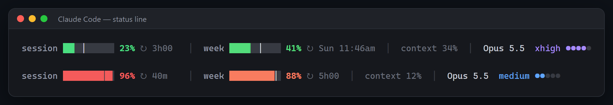

## Install

**Windows:** download `claude-usage-bar-windows-amd64.exe` below (`-arm64` on ARM PCs) and double-click it.

**macOS / Linux:**

```sh
curl -fsSL https://raw.githubusercontent.com/murilo999-666/claude-usage-bar/main/install.sh | sh
```

Then restart Claude Code. More in the [README](https://github.com/murilo999-666/claude-usage-bar#readme).

## Instalar

**Windows:** baixe o `claude-usage-bar-windows-amd64.exe` aqui embaixo e dê dois cliques. **macOS / Linux:** rode o comando acima. Depois reinicie o Claude Code. Mais detalhes no [LEIA-ME](https://github.com/murilo999-666/claude-usage-bar/blob/main/README.pt-BR.md).
