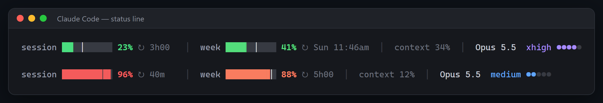

# claude-usage-bar

A colorful usage bar for the [Claude Code](https://claude.com/claude-code) status line. It shows how much of your 5-hour session and your weekly limit you've used, and whether you're on pace, so you don't have to type `/usage`.



**[Leia em português](README.pt-BR.md)**

## What it shows

- **session**: your 5-hour window and how long until it resets
- **week**: your 7-day limit and the day and hour it resets
- **the thin white mark**: the pace, meaning how much of the window has already passed. If the color goes past the mark, you're spending faster than the window lasts.
- context window usage, the model, the effort level (●●●○○) and ⚡ when fast mode is on
- the colors go green → yellow → orange → red as you get close to the limit

The numbers cover your whole account (claude.ai, the desktop and mobile apps, and every Claude Code window), the same numbers `/usage` shows.

## New in v2: Claude Code in tabs (Windows)

On Windows (x64), the same installer also sets up a **Claude Code app**: Claude Code in its own window, with one tab per session, made to work well on half of the screen.

- **Tabs** on the title bar, each with an animated Clawd (working or resting) and the session title. An orange dot means Claude is waiting for you. `+` opens a session; `×` closes it (it asks first if the session is working).
- **Ctrl+→ / Ctrl+←** switch to the next or previous tab.
- **Footer** showing Ready / Working / Waiting for you, with buttons to change the **model** and the **effort**. It types `/model` or `/effort` for you, only when Claude's input box is showing; text you already typed is kept.
- **Drag** the window by the tab bar. Drop it on the left or right edge for half of the screen, on a corner for a quarter, on the top to maximize. New sessions open in the same place.
- **Copy and paste like in a text editor:** select with the mouse, Ctrl+C copies, Ctrl+V pastes text, and a screenshot in the clipboard is pasted as an image.
- The usage bar at the bottom, of course.

The installer downloads the official portable [Windows Terminal](https://github.com/microsoft/terminal) 1.25 (12 MB, checked by SHA-256) into the program's folder, so your installed Windows Terminal stays untouched. Then it adds a **Claude Code** shortcut to the Start menu and the desktop and opens the app. To keep it on the taskbar: right-click its icon → **Pin to taskbar**.

You need Claude Code installed (the `claude` command). Don't want the app? Install with `--no-app`.

## Install

### Windows

1. Download **[claude-usage-bar-windows-amd64.exe](https://github.com/murilo999-666/claude-usage-bar/releases/latest/download/claude-usage-bar-windows-amd64.exe)** ([ARM version](https://github.com/murilo999-666/claude-usage-bar/releases/latest/download/claude-usage-bar-windows-arm64.exe))
2. Double-click it
3. Restart Claude Code

> Windows may say "Windows protected your PC" because the program isn't signed (a signing certificate costs money). Click **More info → Run anyway**. The PowerShell line below skips that screen.

Or paste this in PowerShell:

```powershell
irm https://raw.githubusercontent.com/murilo999-666/claude-usage-bar/main/install.ps1 | iex
```

### macOS and Linux

```sh
curl -fsSL https://raw.githubusercontent.com/murilo999-666/claude-usage-bar/main/install.sh | sh
```

Then restart Claude Code. You don't need Node, Python or anything else.

### What the installer does

- copies itself to `~/.claude/claude-usage-bar/`
- backs up your `settings.json` (`settings.json.bak-claude-usage-bar`) and turns the status line on. It only changes the `statusLine` key; the rest of the file stays byte-for-byte the same.
- keeps your previous status line so uninstalling brings it back
- shows a preview with your current usage
- on Windows x64, installs the tabs app in `~/.claude/claude-usage-bar/app/` (see above)

## Update

Run the installer again.

## Uninstall

**Windows:** press `Win + R`, paste this and press Enter:

```
%USERPROFILE%\.claude\claude-usage-bar\claude-usage-bar.exe uninstall
```

**macOS / Linux:**

```sh
~/.claude/claude-usage-bar/claude-usage-bar uninstall
```

Your previous status line comes back and the program's folder is deleted. On Windows the tabs app and its shortcuts go too; close the app windows first (the uninstaller tells you if one is open).

## Options

Pass them to the installer and they're saved in the status line command, for example `claude-usage-bar-windows-amd64.exe install --lang en --hide model`:

| Option | What it does |
|---|---|
| `--lang en` or `--lang pt` | language (default: your system language) |
| `--hide session,week,context,model,effort` | hide parts of the bar |
| `--bar-width N` | bar width in cells (default 10) |
| `--plain` | no colors (`NO_COLOR` also works) |
| `--no-fetch` | don't query account usage; only use what Claude Code sends |
| `--refresh N` | redraw every N seconds (default 30) |
| `--no-app` | Windows: install only the bar, without the tabs app |

With the macOS/Linux line: `curl -fsSL .../install.sh | sh -s -- --lang en`.

`claude-usage-bar preview` prints the bar with your current usage in any terminal.

## How it works and privacy

- Claude Code runs the program every few seconds and sends the session info (model, context, rate limits) on stdin. The program prints one line.
- For the account-wide numbers, it calls the same endpoint `/usage` uses (`api.anthropic.com/api/oauth/usage`) with the login Claude Code already saved (`~/.claude/.credentials.json`, or the Keychain on macOS). The token only goes to `api.anthropic.com`. Nothing else is sent anywhere and there's no telemetry.
- It makes at most one request per minute, shared by all open windows (cached in `~/.claude/claude-usage-bar/usage.json`), in the background, so the bar never waits for the network. When a request fails it waits 1 minute (5 minutes after HTTP 429) and keeps showing the numbers Claude Code sends.
- That endpoint is not a documented public API. If it changes, the bar falls back to the numbers Claude Code sends by itself.
- The tabs app runs only on your computer and sends nothing: it reads the session files Claude Code writes (`~/.claude/sessions/`) to show each tab's status, and the bar saves each session's model and effort in `%LOCALAPPDATA%\claude-launcher\estado\` for the footer.
- Made for Claude Pro and Max subscriptions. With an API key there are no session or weekly limits, so only the context and the model show up.

Tested on Windows 11 with Claude Code 2.1. The macOS and Linux builds pass the automated tests (including install and uninstall) on GitHub Actions; reports from real use are welcome.

## Build from source

Needs Go 1.24 or newer. No dependencies outside the standard library.

```sh
go test ./...
go build -trimpath -ldflags "-s -w" -o claude-usage-bar .
```

On Windows, build the tabs app first (it uses the C# compiler that comes with Windows, nothing to install): `winapp\build.cmd`. Its code is in [`winapp/`](winapp).

Release files are built by GitHub Actions from this code ([workflow](.github/workflows/build.yml)), with `checksums.txt` and a build provenance attestation you can check with `gh attestation verify <file> --repo murilo999-666/claude-usage-bar`.

## License

[MIT](LICENSE). Free to use, change and share.

Unofficial project, not affiliated with or endorsed by Anthropic. Claude and Claude Code are trademarks of Anthropic.
