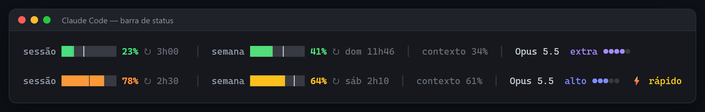

# claude-usage-bar

Uma barra colorida de uso para a barra de status do [Claude Code](https://claude.com/claude-code). Ela mostra quanto você já gastou da sessão de 5 horas e do limite da semana, e se está no ritmo, sem precisar digitar `/usage`.



**[Read in English](README.md)**

## O que aparece

- **sessão**: a janela de 5 horas e quanto falta para renovar
- **semana**: o limite de 7 dias e o dia e a hora em que renova
- **a marquinha branca**: o ritmo, ou seja, quanto da janela já passou. Se a cor passou da marquinha, você está gastando mais rápido do que dá para durar até renovar.
- o uso do contexto, o modelo, o nível de esforço (●●●○○) e o ⚡ quando o modo rápido está ligado
- as cores vão de verde → amarelo → laranja → vermelho conforme chega perto do limite

Os números são da conta inteira (claude.ai, apps do computador e do celular e todas as janelas do Claude Code), os mesmos do `/usage`.

## Novo na v2: o Claude Code em abas (Windows)

No Windows (x64), o mesmo instalador também instala um **app Claude Code**: o Claude Code numa janela própria, com uma aba por sessão, feito para funcionar bem em metade da tela.

- **Abas** na barra de título, cada uma com o Clawd animado (trabalhando ou parado) e o título da sessão. Bolinha laranja = o Claude está esperando você. O `+` abre uma sessão; o `×` fecha (pergunta antes se ela estiver trabalhando).
- **Ctrl+→ / Ctrl+←** vão para a aba do lado.
- **Rodapé** com Pronto / Trabalhando / Esperando você e botões para trocar o **modelo** e o **esforço**. Ele digita o `/model` ou o `/effort` por você, só quando a caixa de texto do Claude está à vista; o que você já tinha digitado fica guardado.
- **Arraste** a janela pelas abas. Solte na borda esquerda ou direita para meia tela, num canto para um quarto, no topo para maximizar. Sessões novas abrem no mesmo lugar.
- **Copiar e colar como num editor de texto:** marque com o mouse, Ctrl+C copia, Ctrl+V cola texto, e um print na área de transferência é colado como imagem.
- E a barra de uso lá embaixo, claro.

O instalador baixa o [Windows Terminal](https://github.com/microsoft/terminal) 1.25 portátil oficial (12 MB, conferido pelo SHA-256) para a pasta do programa, então o Windows Terminal que você já tem não é mexido. Depois cria o atalho **Claude Code** no menu Iniciar e na área de trabalho e abre o app. Para deixar na barra de tarefas: botão direito no ícone dele → **Fixar na barra de tarefas**.

Precisa do Claude Code instalado (o comando `claude`). Não quer o app? Instale com `--no-app`.

## Instalar

### Windows

1. Baixe o **[claude-usage-bar-windows-amd64.exe](https://github.com/murilo999-666/claude-usage-bar/releases/latest/download/claude-usage-bar-windows-amd64.exe)** ([versão ARM](https://github.com/murilo999-666/claude-usage-bar/releases/latest/download/claude-usage-bar-windows-arm64.exe))
2. Dê dois cliques nele
3. Reinicie o Claude Code

> O Windows pode avisar "O Windows protegeu o computador" porque o programa não tem assinatura digital (o certificado é pago). Clique em **Mais informações → Executar assim mesmo**. A linha do PowerShell aí embaixo pula essa tela.

Ou cole isto no PowerShell:

```powershell
irm https://raw.githubusercontent.com/murilo999-666/claude-usage-bar/main/install.ps1 | iex
```

### macOS e Linux

```sh
curl -fsSL https://raw.githubusercontent.com/murilo999-666/claude-usage-bar/main/install.sh | sh
```

Depois reinicie o Claude Code. Não precisa de Node, Python nem de mais nada.

### O que o instalador faz

- copia o programa para `~/.claude/claude-usage-bar/`
- faz uma cópia de segurança do seu `settings.json` (`settings.json.bak-claude-usage-bar`) e liga a barra. Ele só mexe na chave `statusLine`; o resto do arquivo fica igualzinho, byte por byte.
- guarda a sua barra anterior, para a desinstalação trazer ela de volta
- mostra uma prévia com o seu uso de agora
- no Windows x64, instala o app de abas em `~/.claude/claude-usage-bar/app/` (veja acima)

## Atualizar

Rode o instalador de novo.

## Desinstalar

**Windows:** aperte `Win + R`, cole isto e dê Enter:

```
%USERPROFILE%\.claude\claude-usage-bar\claude-usage-bar.exe uninstall
```

**macOS / Linux:**

```sh
~/.claude/claude-usage-bar/claude-usage-bar uninstall
```

A sua barra anterior volta e a pasta do programa é apagada. No Windows o app de abas e os atalhos dele vão junto; feche as janelas do app antes (o desinstalador avisa se tiver alguma aberta).

## Opções

Passe para o instalador e elas ficam gravadas no comando da barra, por exemplo `claude-usage-bar-windows-amd64.exe install --lang pt --hide model`:

| Opção | O que faz |
|---|---|
| `--lang pt` ou `--lang en` | idioma (padrão: o do sistema) |
| `--hide session,week,context,model,effort` | esconde partes da barra |
| `--bar-width N` | largura da barra em células (padrão 10) |
| `--plain` | sem cores (`NO_COLOR` também funciona) |
| `--no-fetch` | não consulta o uso da conta; usa só o que o Claude Code envia |
| `--refresh N` | redesenha a cada N segundos (padrão 30) |
| `--no-app` | Windows: instala só a barra, sem o app de abas |

Na linha do macOS/Linux: `curl -fsSL .../install.sh | sh -s -- --lang pt`.

`claude-usage-bar preview` mostra a barra com o seu uso de agora em qualquer terminal.

## Como funciona e privacidade

- O Claude Code roda o programa a cada poucos segundos e manda as informações da sessão (modelo, contexto, limites) pela entrada padrão. O programa devolve uma linha.
- Para os números da conta inteira, ele consulta o mesmo endereço que o `/usage` usa (`api.anthropic.com/api/oauth/usage`), com o login que o Claude Code já salvou (`~/.claude/.credentials.json`, ou o Keychain no macOS). O token só vai para `api.anthropic.com`. Nada mais é enviado para lugar nenhum e não tem telemetria.
- Faz no máximo uma consulta por minuto, dividida entre todas as janelas abertas (guardada em `~/.claude/claude-usage-bar/usage.json`), em segundo plano, então a barra nunca fica esperando a internet. Se a consulta falha, espera 1 minuto (5 minutos depois de HTTP 429) e continua mostrando os números que o Claude Code envia.
- Esse endereço não é uma API pública documentada. Se ele mudar, a barra continua com os números que o próprio Claude Code envia.
- O app de abas roda só no seu computador e não envia nada: ele lê os arquivos de sessão que o Claude Code grava (`~/.claude/sessions/`) para mostrar o estado de cada aba, e a barra guarda o modelo e o esforço de cada sessão em `%LOCALAPPDATA%\claude-launcher\estado\` para o rodapé.
- Feito para as assinaturas Claude Pro e Max. Com chave de API não existe limite de sessão nem de semana, então só aparecem o contexto e o modelo.

Testado no Windows 11 com o Claude Code 2.1. As versões de macOS e Linux passam nos testes automáticos (instalação e desinstalação inclusive) no GitHub Actions; relatos de uso real são bem-vindos.

## Compilar o código

Precisa do Go 1.24 ou mais novo. Não usa nenhuma biblioteca fora a padrão do Go.

```sh
go test ./...
go build -trimpath -ldflags "-s -w" -o claude-usage-bar .
```

No Windows, compile antes o app de abas (usa o compilador de C# que já vem no Windows, não precisa instalar nada): `winapp\build.cmd`. O código dele está em [`winapp/`](winapp).

Os arquivos das versões são compilados pelo GitHub Actions a partir deste código ([workflow](.github/workflows/build.yml)), com `checksums.txt` e um atestado de origem que dá para conferir com `gh attestation verify <arquivo> --repo murilo999-666/claude-usage-bar`.

## Licença

[MIT](LICENSE). Livre para usar, modificar e compartilhar.

Projeto não oficial, sem ligação com a Anthropic nem aprovação dela. Claude e Claude Code são marcas da Anthropic.
